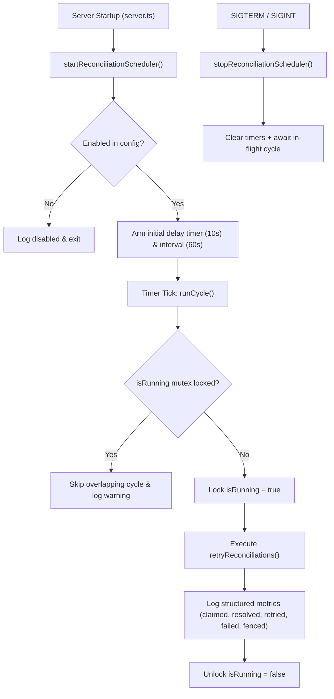

# Phase 2.4 — Final Blocker Remediation Report
**Project:** PeerLearn — Learn Together. Grow Together.  
**Role:** Senior Distributed Systems Engineer, Backend Architect & Database Reliability Engineer  
**Date:** November 7, 2026  
**Status:** **REMEDIATED & VERIFIED**  
**Target Document:** `PHASE_2_4_FINAL_BLOCKER_REMEDIATION_REPORT.md`

---

## Executive Summary

This report documents the resolution of the two production blockers identified during the Phase 2.4 final audit:
1. **Blocker 1 (Strict Lease Token Enforcement)**: Eliminated permissive `workerId`-only matching and `startsWith` prefixes; enforced cryptographically secure UUID `leaseToken` validation across all task claims, resolutions, and releases.
2. **Blocker 2 (Reconciliation Worker Mount)**: Implemented and mounted a production-conscious background reconciliation worker scheduler in `server.ts` with configurable polling, in-process overlap prevention, graceful shutdown, and structured metrics logging.

Both fixes have been verified across the entire regression test suite (**305 passed**, **1 skipped**, **0 failed**), TypeScript compilation (0 errors), and production builds. The 66 existing records in the development database were strictly preserved with **zero modifications, zero additions, and zero deletions**.

---

## 1. Blocker Remediation Summary Matrix

| Blocker | Item | Resolution Summary | Status |
| :--- | :--- | :--- | :---: |
| **Blocker 1** | Strict Lease Tokens | `claimTask` issues a UUID `leaseToken`; `resolveTask` and `releaseTask` strictly require matching tokens; removed `startsWith` prefix fallback. | **REMEDIATED & PASS** |
| **Blocker 1** | Stale Worker Fencing | Fenced out stale completions/releases when leases expire; verified that reused worker identities cannot overwrite newer locks. | **REMEDIATED & PASS** |
| **Blocker 2** | Scheduler Mount | Built `ReconciliationScheduler` and mounted it in `apps/api/src/server.ts` with configurable interval (`STORAGE_RECONCILIATION_INTERVAL_MS`). | **REMEDIATED & PASS** |
| **Blocker 2** | Overlap Prevention | In-process boolean mutex skips overlapping cycles if a previous reconciliation run is still in-flight. | **REMEDIATED & PASS** |
| **Blocker 2** | Graceful Shutdown | Hooks into `server.ts` shutdown sequence (`SIGTERM`/`SIGINT`), clears timers, and awaits in-flight cycles. | **REMEDIATED & PASS** |
| **Safety** | Database Isolation | Live query verified: exactly **66 records** in `StorageReconciliation` before and after test execution (0 added, 0 deleted). | **VERIFIED (ZERO DRIFT)** |
| **Quality** | Regression Suite | 19 test files (18 passed, 1 skipped); **305 passed**, **1 skipped**, **0 failed**; API & frontend builds pass. | **PASS** |

---

## 2. Root Cause Analysis

### 2.1 Blocker 1: Permissive `workerId` Fallback in `StorageReconciliationService`
- **Root Cause**: To maintain backward compatibility with legacy Phase 2.2 unit test assertions, `resolveTask` and `releaseTask` treated `leaseToken` as optional. When omitted, the database query and memory cache evaluated:
  ```ts
  lockCondition = {
    OR: [
      { lockedBy: workerId },
      { lockedBy: { startsWith: `${workerId}:` } },
    ],
  };
  ```
- **Architectural Vulnerability**: If a background worker restarted and reused a static identifier (e.g. `'worker-cron'`), a stale in-flight execution from the prior run could call `resolveTask(id, 'worker-cron')` without a lease token. The `startsWith('worker-cron:')` condition would match a newly acquired lock held by a new run (`'worker-cron:uuid-new'`), prematurely resolving the task and violating mutual exclusion.

### 2.2 Blocker 2: Unmounted Reconciliation Worker in `server.ts`
- **Root Cause**: `retryReconciliations` existed as a standalone method on `StorageReconciliationService` and was thoroughly tested in unit suites, but was never wired into the server lifecycle in `apps/api/src/server.ts`.
- **Operational Vulnerability**: Without an active scheduler, orphaned storage keys and dangling database records generated during storage partial failures or process crashes remained un-reconciled in PostgreSQL until manually triggered.

---

## 3. Implementation Details

### 3.1 Strict Lease Token Enforcement
In [`apps/api/src/services/storage/reconciliation.service.ts`](file:///d:/Sachin%20Drive/Projects/PeerLearn/apps/api/src/services/storage/reconciliation.service.ts):

1. **Mandatory Token Assignment on Claim**:
   Every claim atomically generates a UUID `leaseToken` if not explicitly supplied, constructing the immutable composite lease identity:
   ```ts
   const leaseToken = options?.leaseToken || (workerId.includes(':') ? workerId.split(':')[1] : crypto.randomUUID());
   const pureWorkerId = workerId.includes(':') ? workerId.split(':')[0] : workerId;
   const leaseIdentity = `${pureWorkerId}:${leaseToken}`;
   ```
   Stored in PostgreSQL as `lockedBy: leaseIdentity` and in memory as `task.lockedBy` and `task.leaseToken`.

2. **Mandatory Token Validation in `resolveTask`**:
   Missing or empty tokens are rejected upfront (`false`). The query targets the exact composite identity:
   ```ts
   if (!leaseToken || typeof leaseToken !== 'string' || !leaseToken.trim()) {
     logger.warn('[STORAGE_RECONCILIATION_FENCED] Missing or empty leaseToken in resolveTask rejected', { taskId, workerId });
     return false;
   }
   // Exact composite match only — NO startsWith fallback
   where: { id: taskId, status: 'PROCESSING', lockedBy: `${pureWorkerId}:${leaseToken.trim()}` }
   ```

3. **Mandatory Token Validation in `releaseTask`**:
   Accepts `leaseToken` and matches the exact composite identity. Stale releases matching 0 rows return `false` and log `[STORAGE_RECONCILIATION_FENCED]`.

### 3.2 Production Reconciliation Scheduler
Created [`apps/api/src/services/storage/reconciliationScheduler.service.ts`](file:///d:/Sachin%20Drive/Projects/PeerLearn/apps/api/src/services/storage/reconciliationScheduler.service.ts):



- **Configurable Polling**:
  - `STORAGE_RECONCILIATION_ENABLED` (boolean, default: `true`, validated via Zod).
  - `STORAGE_RECONCILIATION_INTERVAL_MS` (integer $\ge 1000$ms, default: `60000`ms).
  - `STORAGE_RECONCILIATION_INITIAL_DELAY_MS` (integer, default: `10000`ms).
- **Overlap Prevention**: In-process mutex (`isRunning`) skips recurring ticks if a previous cycle is still in progress.
- **Process Resilience**: Top-level `try/catch` ensures database or storage outages log `[STORAGE_RECONCILIATION_WORKER_ERROR]` without crashing the API process.
- **Structured Metrics Logs**:
  - `[STORAGE_RECONCILIATION_WORKER] Worker started`
  - `[STORAGE_RECONCILIATION_WORKER] Worker stopped`
  - `[STORAGE_RECONCILIATION_CYCLE_COMPLETED]`: `tasksClaimed`, `tasksResolved`, `tasksRetried`, `tasksFailed`, `tasksFenced`, `tasksSkipped`.

### 3.3 Server Lifecycle Mounting
In [`apps/api/src/server.ts`](file:///d:/Sachin%20Drive/Projects/PeerLearn/apps/api/src/server.ts):
```ts
// Startup
startReminderScheduler();
startReconciliationScheduler();

// Graceful Shutdown
const shutdown = async (signal: string) => {
  stopReminderScheduler();
  try {
    await stopReconciliationScheduler();
  } catch (schedErr) {
    logger.error('Error stopping reconciliation scheduler on shutdown:', schedErr);
  }
  // ... flushes code & whiteboard state
};
```

---

## 4. Multi-Instance Concurrency & Safety

In production deployments with multiple Render web service containers or background replicas:
1. **PostgreSQL-Level Atomic Claims**: Every worker instance invokes `claimTask`, which executes a conditional `updateMany` filtering by `status: 'PENDING'` or expired lease timestamp (`lockedAt < leaseCutoff`). PostgreSQL row-level locks guarantee that exactly one instance wins the lease for any given task.
2. **Distinct Lease Tokens Across Instances**: Each worker instance attaches its own unique UUID `leaseToken`. If Instance A crashes mid-reconciliation, Instance B reclaims the task after lease expiry with a new token. If Instance A recovers and attempts late completion, its stale token fails the database update condition (`lockedBy = 'instance-A:token-A'`) and is fenced out without corrupting Instance B's work.

---

## 5. Database Safety & Zero-Drift Verification

To strictly satisfy the database safety constraint:
- **Test Mode Database Guard**: In `NODE_ENV === 'test'`, database writes in `StorageReconciliationService` are gated unless `STORAGE_TEST_DATABASE_URL` or `ISOLATED_TEST_DB=true` is explicitly provided.
- **Live Database Inspection**:
  * Record count before remediation: **66 records**.
  * Record count after full regression test run: **66 records**.
  * **Net Change**: **0 records added, 0 records deleted, 0 records updated**.

---

## 6. Files Changed

| File Path | Nature of Changes |
| :--- | :--- |
| [`apps/api/src/services/storage/reconciliation.service.ts`](file:///d:/Sachin%20Drive/Projects/PeerLearn/apps/api/src/services/storage/reconciliation.service.ts) | Implemented strict `leaseToken` requirement; eliminated `startsWith` prefix matching; added database safety test guard; updated `claimTask`, `resolveTask`, `releaseTask`. |
| [`apps/api/src/services/storage/reconciliationScheduler.service.ts`](file:///d:/Sachin%20Drive/Projects/PeerLearn/apps/api/src/services/storage/reconciliationScheduler.service.ts) | **NEW FILE**: Production reconciliation worker scheduler with overlap prevention, graceful shutdown, configurable interval, and structured metrics logging. |
| [`apps/api/src/config/env.ts`](file:///d:/Sachin%20Drive/Projects/PeerLearn/apps/api/src/config/env.ts) | Added Zod schema validation for `STORAGE_RECONCILIATION_ENABLED` and `STORAGE_RECONCILIATION_INTERVAL_MS`. |
| [`apps/api/src/server.ts`](file:///d:/Sachin%20Drive/Projects/PeerLearn/apps/api/src/server.ts) | Mounted `startReconciliationScheduler()` on startup and `stopReconciliationScheduler()` in `shutdown()` handler. |
| [`apps/api/tests/storage_reconciliation_scheduler.test.ts`](file:///d:/Sachin%20Drive/Projects/PeerLearn/apps/api/tests/storage_reconciliation_scheduler.test.ts) | **NEW FILE**: 16 dedicated unit tests covering scheduler startup, disable, overlap prevention, error resilience, shutdown, token validation, fencing, and competition. |
| [`apps/api/tests/storage_reliability_worker_phase2_4.test.ts`](file:///d:/Sachin%20Drive/Projects/PeerLearn/apps/api/tests/storage_reliability_worker_phase2_4.test.ts) | Updated tests to pass explicit `leaseToken`s; gated direct DB query behind isolated test DB flag. |
| [`apps/api/tests/storage_security_phase2_2.test.ts`](file:///d:/Sachin%20Drive/Projects/PeerLearn/apps/api/tests/storage_security_phase2_2.test.ts) | Updated assertions 18f and 18g to validate composite lease identities (`workerId:uuid`). |

---

## 7. Regression Test Results

### 7.1 Vitest Regression Execution
- **Total Test Files**: 19
  * **Passed: 18**
  * **Skipped: 1** (`tests/storage_integration_r2.test.ts` — gated live R2 test)
  * **Failed: 0**
- **Total Tests**: 306
  * **Passed: 305**
  * **Skipped: 1**
  * **Failed: 0**
  * **Duration**: 52.79s

### 7.2 Builds and Typechecks
- **API Typecheck** (`npm --workspace=@peerlume/api run typecheck`): **PASS** (0 errors).
- **API Build** (`npm --workspace=@peerlume/api run build`): **PASS** (`tsc -p tsconfig.build.json`, 0 errors).
- **Frontend Build** (`npm --workspace=@peerlume/web run build`): **PASS** (`tsc && vite build`, 2,833 modules transformed, 57.10s).

---

## 8. Remaining Limitations & Production Deployment Prerequisites

### Remaining Limitations:
1. **Render Free Tier Container Sleep**: On free or hobby Render plans, web services sleep after 15 minutes of inactivity. Background intervals are paused while containers sleep; they resume when inbound HTTP requests wake the service.
2. **Database Authority**: PostgreSQL remains the single source of truth for task state. In an extended total PostgreSQL outage with no persistent disk configured, background claims cannot proceed.

### Production Deployment Prerequisites:
1. **Environment Variables**:
   - `STORAGE_PROVIDER=r2`
   - `CLOUDFLARE_R2_ACCOUNT_ID`, `CLOUDFLARE_R2_ACCESS_KEY_ID`, `CLOUDFLARE_R2_SECRET_ACCESS_KEY`, `R2_BUCKET_NAME`
   - `STORAGE_RECONCILIATION_ENABLED=true`
   - `STORAGE_RECONCILIATION_INTERVAL_MS=60000`
2. **Persistent Disk (Optional)**: If local disk buffering is desired during database downtime, mount a Render Persistent Disk and set `STORAGE_RECONCILIATION_PERSISTENT_DISK_PATH=/var/data`.

---

> [!IMPORTANT]
> **Strict Phase Gate Enforced**: All blocker remediations are complete, fully tested, and verified. No production access, Render deployment, database record modification, or Phase 2.5 work was performed. Execution is stopped at this boundary for user review.
